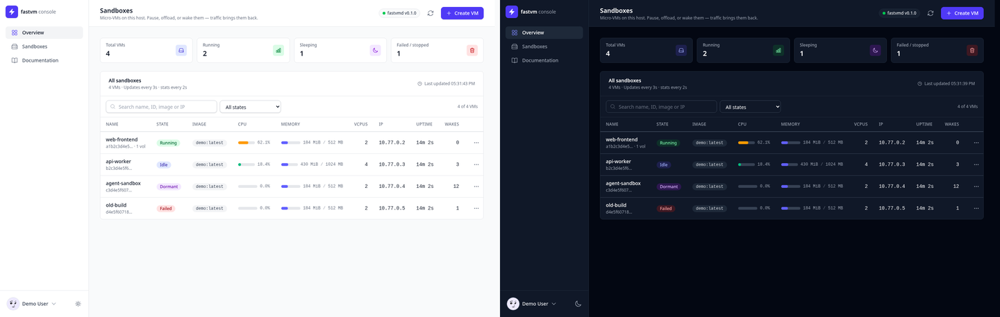

# fastvm

Micro-VMs that nap.

A single-host sandbox runtime built on **Cloud Hypervisor**/KVM: sandboxes
cold-boot in **~0.6 s** (measured to guest-agent-ready on the reference host),
put themselves to sleep when idle, page their memory to disk, and wake
themselves when a packet arrives — with the frame already queued in the guest's
own virtio-net path. Host directories can be shared into a sandbox over
virtio-fs.



## Features

- **~0.6 s cold boots.** One [Cloud Hypervisor](https://www.cloudhypervisor.org/)
  microVM per sandbox, KVM-backed (boot to guest-agent-ready, measured on the
  reference host; see the [migration notes](docs/CLOUD_HYPERVISOR_MIGRATION.md)
  for why the old Firecracker "~100 ms" number no longer applies).
- **`fastvmctl`, built for the terminal.** Cobra + Fang command tree with styled
  help/errors, shell completion, and `--version`. One `run` command creates,
  boots, and executes; foreground runs clean up on exit, while `-d`/`--no-start`
  keep the sandbox. `resume` boots Created sandboxes and wakes Paused/Dormant
  ones. `rm` accepts multiple names.
- **Self-managed lifecycle.** Idle detection → pause (vCPUs halted, RAM
  resident) → dormant (RAM offloaded to a file-backed snapshot) → destroy.
- **Wake on network.** A packet arriving for a sleeping sandbox wakes it, with
  the frame already queued in the guest's RX path. `curl` a dormant VM and it
  answers.
- **On-demand images with progress.** `run --image alpine` builds and caches a
  bootable base disk automatically, showing a Bubbles spinner; `image build`
  remains available for explicit Dockerfile builds. Runtime disks are reflink
  CoW clones with a sparse-copy fallback.
- **Explicit network policy.** `--net`/`--no-net` choose whether a guest gets a
  NIC. `--allow-host` resolves hostnames into an nftables egress allowlist;
  blocked TCP connections get an immediate RST instead of a long timeout
  (bridge mode; eBPF mode rejects allowlisted sandboxes).
- **Checkpoints and live copies.** `checkpoint save` captures RAM, CPU state,
  and the writable disk; `checkpoint restore` boots a copy elsewhere;
  `checkpoint copy` creates a running child with its own disk, IP, and hostname.
  No separate branching mode is required.
- **eBPF L2 switch** by default: tc redirect between TAPs and the uplink,
  sandbox isolation, MAC/IP anti-spoofing, ringbuf wake events — with an
  automatic Linux-bridge + AF_PACKET fallback.
- **Host-directory volumes over virtio-fs.** Allowlisted host paths can be
  mounted at guest paths read-only or read-write (`--volume host:guest[:ro]`,
  `volumes` in the API); virtiofsd serves them and they survive pause/dormant
  wake. Host mounts are denied unless enabled in `volumes.allowed_host_prefixes`.
- **exec over virtio-vsock**, detached workloads, and an interactive PTY shell
  with resize and exit-code propagation.
- **Published ports** with nftables DNAT, including `curl 127.0.0.1:<port>`.
- **Baked-in coding-agent templates**: `fastvmctl template start claude|codex|copilot`.
- **Docker-style guest identity** on every boot (`/etc/hostname`, `/etc/hosts`,
  `/etc/resolv.conf` with host resolvers mirrored).
- **HTTP/JSON API**, event log, sandbox introspection, and graceful
  daemon-restart adoption of active sandboxes.
- **Web console** (`console/`): Keycloak OIDC sign-in, a live sandbox table with
  per-VM CPU/memory utilization, lifecycle actions, and an interactive exec
  terminal.

## Try it

Build and install the binaries and pinned kernel, then run the daemon and drive
it with `fastvmctl`:

```sh
# build and install (usually /usr/local/bin)
make build && make assets   # binaries + pinned Cloud Hypervisor kernel
sudo make install

# terminal 1 — root daemon with the demo config
sudo fastvmd --config hack/config.yaml

# terminal 2
# one-shot command: image built on demand, output printed, sandbox removed on exit
fastvmctl run --image alpine -- uname -a

# interactive shell: removed when you exit
fastvmctl run --net -it --image alpine -- /bin/sh

# named sandbox you can exec into, pause, and wake
fastvmctl run -d --net --image alpine --name dev -- sh -c 'sleep infinity'
fastvmctl exec dev -- uname -a
fastvmctl pause dev --deep
fastvmctl resume dev
fastvmctl rm dev

# egress allowlist: only example.com is reachable; google.com fails fast
fastvmctl run --net --image alpine --allow-host example.com -- \
  wget -T 2 -t 1 -qO- https://google.com
```

On-demand image builds show a Bubbles progress display. Host volumes, published
ports, checkpoints, and templates are covered in
[docs/FASTVMCTL.md](docs/FASTVMCTL.md) and
[docs/GETTING_STARTED.md](docs/GETTING_STARTED.md).

## Checkpoints

A checkpoint saves the sandbox’s running state — RAM, CPU, and writable disk —
so it can be copied live or restored later/elsewhere.

```sh
# Boot the original with a long-running workload
fastvmctl run -d --net --image alpine --name original-vm -- sh -c 'sleep 600'

# Change its state after boot so copies prove they came from the live VM
fastvmctl exec original-vm -- sh -c 'echo "created before checkpoint" > /root/checkpoint-source.txt'

# Copy the live sandbox into an independent child
fastvmctl checkpoint copy --from original-vm --name copy-1
fastvmctl exec copy-1 -- cat /root/checkpoint-source.txt
fastvmctl exec copy-1 -- sh -c 'ps | grep "[s]leep 600"'   # process survived

# Save the original’s running state to a directory
fastvmctl checkpoint save --name original-vm -o original-vm.checkpoint

# Restore it as a new running sandbox
fastvmctl checkpoint restore --from original-vm.checkpoint --name copy-2
fastvmctl exec copy-2 -- cat /root/checkpoint-source.txt
fastvmctl exec copy-2 -- sh -c 'ps | grep "[s]leep 600"'  # process survived

fastvmctl rm copy-1 copy-2 original-vm
```

Checkpoints are directories on the daemon host; the base image referenced by
the checkpoint must still exist when restoring. Host-directory mounts are not
included in checkpoints.

## Web console

Setup, OIDC, the exec terminal and API details live in [console/README.md](console/README.md).

## Requirements

Linux x86_64 with KVM, [Cloud Hypervisor](https://www.cloudhypervisor.org/)
v54+ (`cloud-hypervisor`, or the static build `cloud-hypervisor-static`),
virtiofsd ≥ 1.10 (only for host-directory volumes), and Go 1.24+ to build. The
daemon needs root/`CAP_NET_ADMIN` for TAP/veth/nftables; `CAP_BPF` enables the
eBPF switch, otherwise it falls back to the Linux bridge. Docker/BuildKit is
optional and only used to build base disks and template images.

## Documentation

| Document | What it covers |
|---|---|
| [Getting started](docs/GETTING_STARTED.md) | Build, config, images, sandboxes, shell, wake-on-network, testing, troubleshooting |
| [Design](docs/DESIGN.md) | Goals, architecture, lifecycle, storage, networking, security, roadmap |
| [CoW volumes](docs/SETUP_COW_VOLUME.md) | Loopback XFS setup, reflink verification |
| [Cloud Hypervisor migration](docs/CLOUD_HYPERVISOR_MIGRATION.md) | Why the VMM moved from Firecracker to Cloud Hypervisor, kernel/tooling, virtio-fs volumes |
| [fastvmctl CLI](docs/FASTVMCTL.md) | Command surface, lifecycle semantics, networking/allowlists, checkpoints |
| [Web console](console/README.md) | OIDC login, sandbox dashboard, live utilization, exec terminal, dev proxy, production notes |
| [Docs index](docs/README.md) | All documents and the repository layout |

## Development

```sh
make build     # bin/fastvmctl (+ fastvm symlink), bin/fastvmd, bin/fastvm-agent
make test      # unit tests (no KVM or root needed)
make test-race # unit tests under the race detector
make e2e       # real Cloud Hypervisor boot/pause/dormant/wake e2e
```

Gated e2e, network, and Docker-build suites skip cleanly when their
prerequisites are missing — see
[docs/GETTING_STARTED.md § Testing](docs/GETTING_STARTED.md#10-testing) for the
commands and the verified test matrix.
